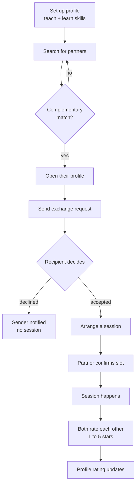
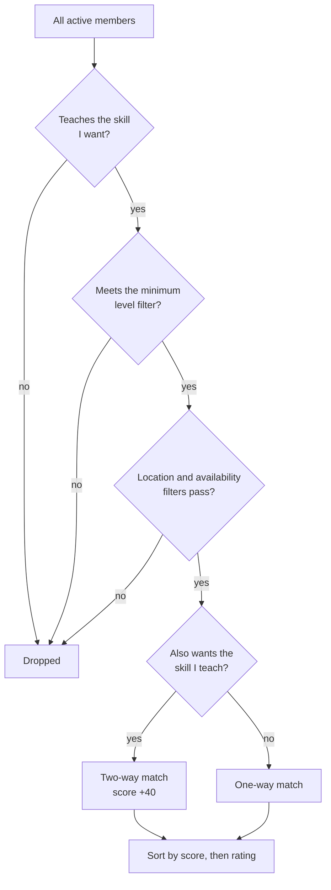
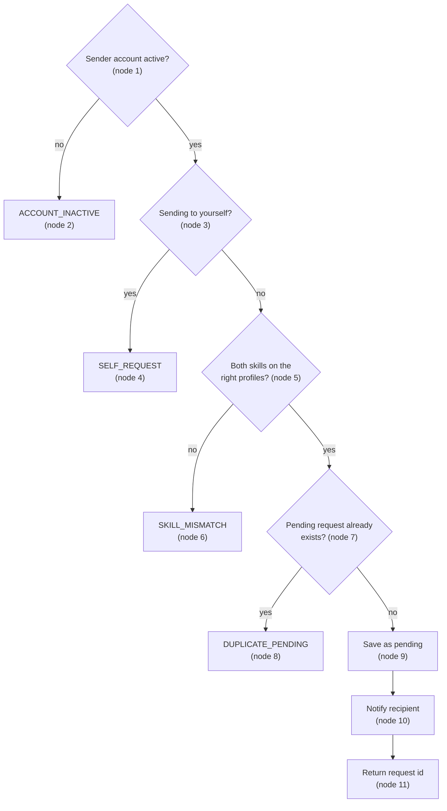
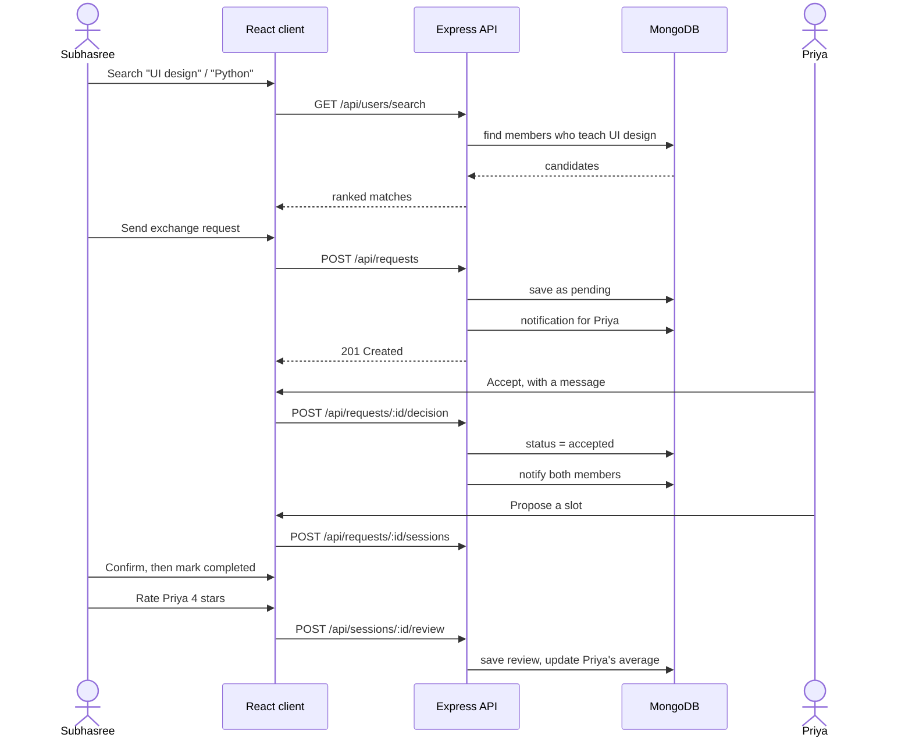
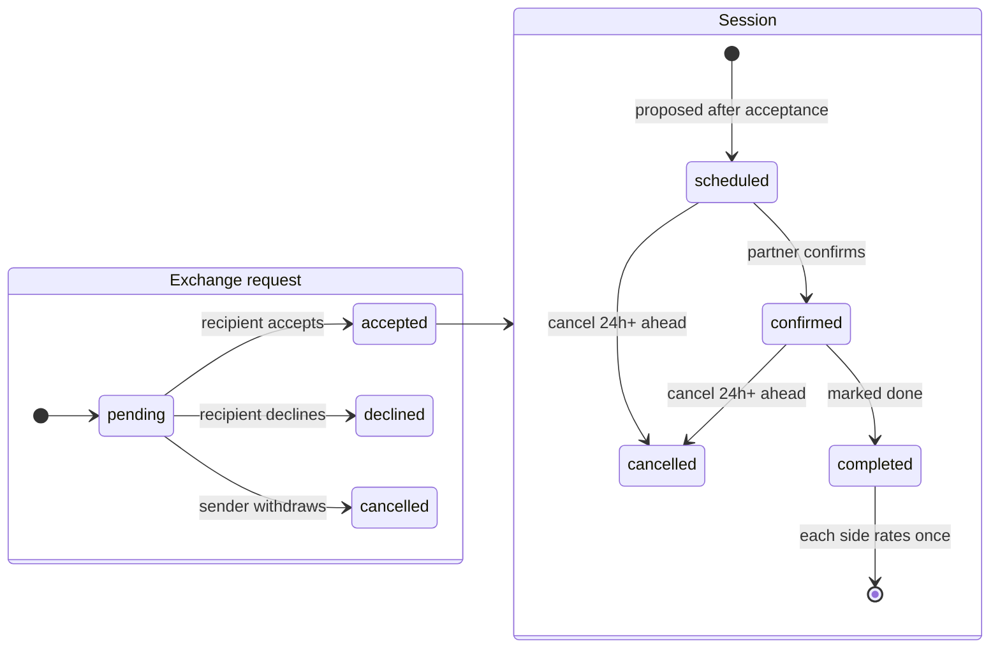
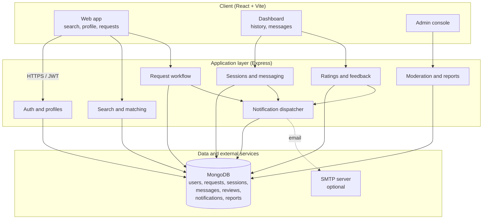
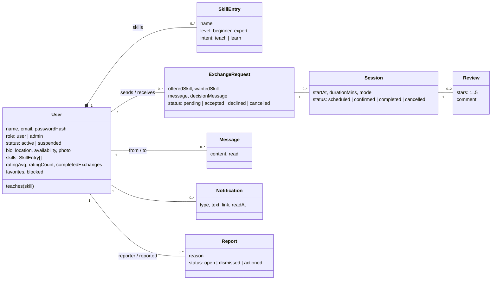
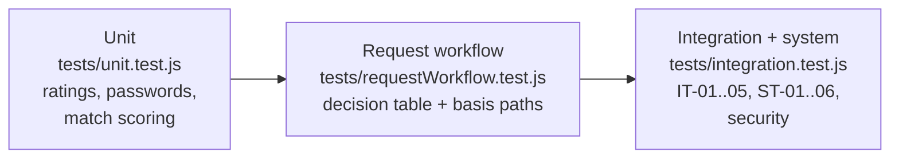
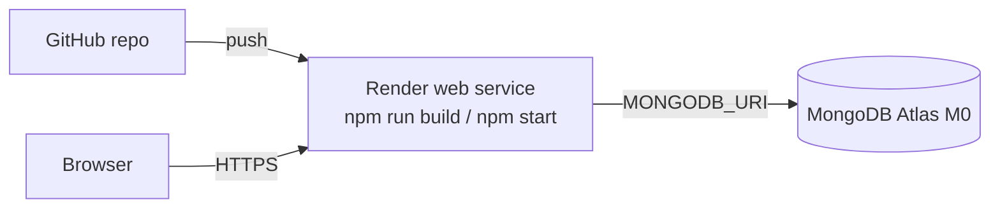

# ConnectX

A skill exchange platform. You list what you can teach and what you want to learn, ConnectX finds people whose skills fit yours the other way round, and then handles the rest: the request, the yes or no, scheduling a session, chatting, and rating each other afterwards.

This is the MERN proof of concept for our Software Engineering lab (PCC-CS504, IEM Kolkata). It's built from our own SRS, HLD and test plan, so the requirement IDs (FR-x, NFR-x) and test IDs (DT-01, P3, IT-04 ...) used below are the ones from those documents.

**Team 4, Section B (2024–2028)**

| Name | Roll | Role |
|---|---|---|
| Kanishka Bhadra | 90 | Developer |
| Oindreela Saha | 92 | Project manager, developer |
| Anushka Mukherjee | 94 | Developer, testing |
| Subhasree Paul | 103 | Developer, designer, test lead |

## Contents

- [Quick start](#quick-start)
- [Demo accounts](#demo-accounts)
- [How it works](#how-it-works)
- [Architecture](#architecture)
- [Data model](#data-model)
- [Requirements covered](#requirements-covered)
- [Tests](#tests)
- [Deploying](#deploying)
- [API reference](#api-reference)
- [Project layout](#project-layout)

## Quick start

You need Node 18 or newer and a MongoDB to connect to, either `mongod` running locally or a free Atlas cluster.

```bash
git clone https://github.com/6289subhasree/connectx.git
cd connectx
cp server/.env.example server/.env   # change MONGODB_URI if you're not on local Mongo
npm run build                         # installs server + client, builds the React app
npm run seed                          # loads the demo users
npm start                             # http://localhost:5000
```

For development, run the two halves separately so React hot-reloads:

```bash
npm run dev --prefix server    # API on :5000
npm run dev --prefix client    # Vite on :5173, proxies /api to :5000
```

**Paid APIs used: none.** Email is optional. Point `SMTP_*` in `.env` at any SMTP server (a Gmail app password works, or MailHog locally). If you leave it blank, emails are printed to the server log and the password reset link is shown on screen instead.

## Demo accounts

Every seeded account uses the password `Connect@123`.

| Email | What it's set up for |
|---|---|
| `subhasree@example.com` | Teaches Python, wants UI design. Has a pending request from Rahul waiting. |
| `priya@example.com` | Teaches UI design, wants Python. Shows up as the top match for Subhasree. |
| `arjun@example.com` | Second two-way match for the same search. |
| `rahul@example.com` | Teaches guitar. Use him for the decline flow. |
| `admin@connectx.com` | Admin console, with one open report to act on. |

Run `npm run seed` again any time you want to reset the data before a demo.

## How it works

The main journey, from finding someone to rating them:



### Matching

Search takes "I want to learn" and "I can teach". A candidate has to teach the skill you want. If they also want to learn the skill you teach, it's a **two-way match** and scores higher. After that, results are ordered by rating.



Blocked members, suspended accounts and admins never show up in search.

### Sending a request

Before a request is saved, the server checks four things in order. This is `createRequest()` in `server/src/services/requestService.js`, written to follow the control flow graph in section B.8 of our test plan node for node.



Four decisions, so V(G) = 4 + 1 = 5, which is also E − N + 2 = 15 − 12 + 2. Each of the five paths has its own test (P1 to P5).

### What happens between the two members



### Request and session states

Only these transitions are allowed. Anything else, like accepting a request that was already declined, gets a `409 INVALID_TRANSITION`.



## Architecture

It's the same three layers as section 7 of our HLD. One Node process serves both the API and the built React app, so the whole thing deploys as a single service.



A few decisions worth knowing about:

- **Sessions time out after 30 minutes idle (FR-2).** Each JWT lasts 30 minutes, and every authenticated response sends a fresh one back in the `X-Refresh-Token` header. If you keep using the app you stay logged in. If you leave it for 30 minutes, you don't.
- **The profile lives inside the user document.** The HLD has User and SkillProfile as a 1:1 pair, and in Mongo that's simplest as one document with an embedded `skills` array.
- **The average rating is stored on the user,** so search can sort by it without recomputing. It's updated incrementally each time a review comes in.
- **Profile photos are stored as data URLs in Mongo.** That keeps them under 5 MB (FR-10) without needing separate file storage on the free hosting tier.
- **Security (NFR-2):** passwords are hashed with bcrypt, Helmet sets a Content-Security-Policy, `express-mongo-sanitize` strips `$` operators from input, auth routes are rate-limited, and every request or session endpoint checks that you're actually one of the two people involved.

## Data model



All models are in `server/src/models/`.

## Requirements covered

| ID | Requirement | Where it lives |
|---|---|---|
| FR-1 | Register with a valid email and a password of 8+ characters with upper, lower and a digit | `routes/auth.js` |
| FR-2 | Login, 30-minute inactivity timeout | `middleware/auth.js` |
| FR-3 | Skill profile: name, level, teach or learn | `PUT /api/users/me`, `MyProfile.jsx` |
| FR-4 | Search complementary partners, sorted by rating | `services/matchService.js` |
| FR-5 | Send a request naming both skills | `services/requestService.js` |
| FR-6 | Accept or decline, with an optional message | `POST /api/requests/:id/decision` |
| FR-7 | Schedule a session, partner confirms | `POST /api/requests/:id/sessions` |
| FR-8 | Messaging between partners | `Messages.jsx`, `/api/messages` |
| FR-9 | 1–5 star rating and written feedback | `POST /api/sessions/:id/review` |
| FR-10 | Profile photo, JPEG or PNG up to 5 MB | `POST /api/users/me/photo` |
| FR-11 | Bio up to 500 characters | `MyProfile.jsx` |
| FR-12 | Notifications for requests, decisions, sessions, messages, ratings | `services/notificationService.js` |
| FR-13 | History of past and ongoing exchanges | Exchanges page, "Accepted & history" tab |
| FR-14 | Cancel a session at least 24 h ahead, partner notified | `POST /api/sessions/:id/cancel` |
| FR-15 | Block or report a member | `/api/users/:id/block`, `/report` |
| FR-16 | Admin reviews reports, suspends accounts | `Admin.jsx`, `/api/admin` |
| FR-17 | Password reset through a 15-minute, single-use link | `/api/auth/forgot`, `/api/auth/reset/:token` |
| FR-18 | Average rating and completed exchanges on the profile | `Profile.jsx` |
| FR-19 | Favourite partners | `Favorites.jsx` |
| FR-20 | Filter by level, location, availability | Search page |
| NFR-2 | bcrypt, CSP, injection and XSS protection | `app.js` |
| NFR-3 | Works from 320 px to 2560 px wide | `client/src/styles.css` |

## Tests

```bash
npm test
```

That runs 50 Jest + Supertest cases against a real database (`MONGODB_URI_TEST`, which defaults to a local `connectx_test`). Each test is named after its ID in the test plan, so you can go from the document straight to the code.



| Test plan section | Cases | File |
|---|---|---|
| B.6 Equivalence classes and boundary values, star rating | EP-01..03, BVA-01..06 | `unit.test.js` |
| FR-1 password length boundaries 7 / 8 / 64 / 65 | 5 cases | `unit.test.js` |
| B.7 Decision table | DT-01..DT-04 | `requestWorkflow.test.js` |
| B.8 Basis paths | P1..P5 | `requestWorkflow.test.js` |
| B.9 Integration | IT-01..IT-05, plus an invalid state transition | `integration.test.js` |
| B.10 System | ST-01, 02, 04, 05, 06 | `integration.test.js` |
| A.5 Security | unauthenticated access, other users' requests, NoSQL injection, bcrypt, admin-only routes, reset link reuse | `integration.test.js` |

The service layer is at about 86% statement coverage; the plan's target is 80%. GitHub Actions (`.github/workflows/ci.yml`) runs the suite against a Mongo container on every push, then builds the client.

## Deploying

We use Render for the app and MongoDB Atlas for the database. Both have free tiers that are enough for this.



1. **Atlas:** create a free M0 cluster, add a database user, and allow access from `0.0.0.0/0` under Network Access. Copy the connection string and put `/connectx` before the `?`.
2. **Render:** choose New → Blueprint and pick this repo. It reads `render.yaml`. Paste the Atlas string when it asks for `MONGODB_URI`, then deploy. `JWT_SECRET` is generated for you, and `SEED_ON_START=true` loads the demo accounts the first time the database is empty.
3. Free Render services go to sleep after about 15 minutes with no traffic, and the first request after that takes close to a minute. Open the site a little before you need it.

Environment variables (see `server/.env.example`):

| Variable | Required | Notes |
|---|---|---|
| `MONGODB_URI` | yes | Atlas or local connection string |
| `JWT_SECRET` | yes | any long random string |
| `PORT` | no | defaults to 5000 |
| `SEED_ON_START` | no | `true` seeds demo data when the DB is empty |
| `SMTP_HOST`, `SMTP_PORT`, `SMTP_USER`, `SMTP_PASS`, `MAIL_FROM` | no | enables real emails |
| `APP_URL` | no | base URL used in reset-link emails |

## API reference

Everything is under `/api`. Routes marked with 🔒 need `Authorization: Bearer <token>`.

| Method | Route | What it does |
|---|---|---|
| POST | `/auth/register` | create an account |
| POST | `/auth/login` | sign in, returns a token |
| GET 🔒 | `/auth/me` | current user |
| POST | `/auth/forgot` | send a password reset link |
| POST | `/auth/reset/:token` | set a new password |
| PUT 🔒 | `/users/me` | update profile and skills |
| POST 🔒 | `/users/me/photo` | upload a profile photo (multipart, field `photo`) |
| GET 🔒 | `/users/search?want=&teach=&level=&availability=&location=` | find matches |
| GET 🔒 | `/users/:id` | public profile and recent reviews |
| POST 🔒 | `/users/:id/favorite` | toggle favourite |
| POST 🔒 | `/users/:id/block` | toggle block |
| POST 🔒 | `/users/:id/report` | report a member |
| GET 🔒 | `/users/favorites` | my favourites |
| POST 🔒 | `/requests` | send an exchange request |
| GET 🔒 | `/requests` | all my requests, with their sessions |
| POST 🔒 | `/requests/:id/decision` | `{ decision: "accepted" \| "declined", message }` |
| POST 🔒 | `/requests/:id/cancel` | withdraw a pending request |
| POST 🔒 | `/requests/:id/sessions` | propose a session `{ startAt }` |
| POST 🔒 | `/sessions/:id/confirm` | partner confirms the slot |
| POST 🔒 | `/sessions/:id/cancel` | cancel (24 h or more ahead) |
| POST 🔒 | `/sessions/:id/complete` | mark as done |
| POST 🔒 | `/sessions/:id/review` | `{ stars, comment }` |
| GET 🔒 | `/messages` | conversation list |
| GET / POST 🔒 | `/messages/:userId` | read or send messages |
| GET 🔒 | `/notifications` | latest 30 |
| POST 🔒 | `/notifications/read` | mark all as read |
| GET 🔒 | `/admin/reports`, `/admin/stats` | admin only |
| POST 🔒 | `/admin/reports/:id` | `{ action: "suspend" \| "reinstate" \| "dismiss" }` |

Errors come back as `{ "error": "readable message", "code": "SKILL_MISMATCH" }` with a matching HTTP status.

## Project layout

```
connectx/
├── server/
│   ├── src/
│   │   ├── app.js              express setup, security middleware, serves client/dist
│   │   ├── server.js           connects to Mongo and starts listening
│   │   ├── seed.js             demo data
│   │   ├── models/             User, ExchangeRequest, Session, Message, Review, Notification, Report
│   │   ├── services/           requestService, matchService, reviewService, notificationService
│   │   ├── routes/             auth, users, exchange, misc (messages, notifications, admin)
│   │   └── middleware/auth.js  JWT check and the 30-minute idle timeout
│   └── tests/
├── client/
│   └── src/
│       ├── pages/              Login, Register, Password, Search, Profile, Requests,
│       │                       Messages, MyProfile, Favorites, Admin
│       ├── components/         Nav, Avatar
│       └── api.js              fetch wrapper that handles the refreshed token
├── render.yaml
├── DEMO_SCRIPT.md              what to show, and in what order, for the POC demo
└── .github/workflows/ci.yml
```

## Not done yet

These are from the open issues in our SRS (section 5.3) and are out of scope for the POC: video calls inside the app, AI skill recommendations, badges, multiple languages, and payments for premium features.
